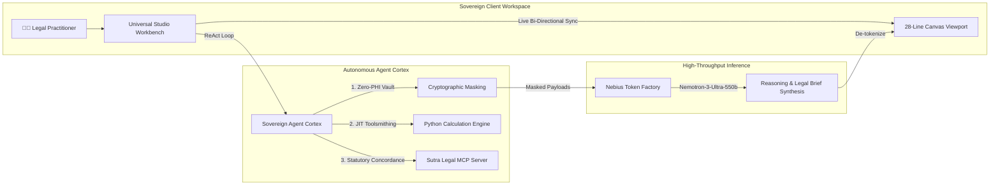

<div align="center">

# ⚖️ SutraFlow AI
### Sovereign Legal Practice Controller & Autonomous ReAct Agent
**Powered by NVIDIA Nemotron-3-Ultra-550b on Nebius Token Factory**

[](https://build.nvidia.com)
[](https://studio.nebius.ai)
[](LICENSE)
[-success)](docs/ARCHITECTURE.md)
[](https://www.typescriptlang.org/)
[](https://vitejs.dev/)

*An air-gapped, zero-PHI sovereign legal operating system engineered for high-stakes litigation, California Workers' Compensation, and automated 28-line judicial pleading compilation.*

</div>

---

## 🌟 Executive Overview

**SutraFlow AI** is a deterministic, sovereign practice controller engineered for attorneys, hearing representatives, and legal practitioners operating in highly regulated fields. Built on **NVIDIA Nemotron-3-Ultra-550b** and served via the **Nebius Token Factory**, SutraFlow transforms complex case management, medical-legal chronologies, statutory calculations, and court filings into an autonomous multi-turn ReAct workflow.

Unlike generic conversational AI tools, SutraFlow operates with **zero hallucination**, strict **zero-PHI cryptographic tokenization**, and native **28-line California pleading formatting**.



---

## 🏛️ The 6 Power Pillars

SutraFlow consolidates the entire legal enterprise into six focused operational pillars:

### 1. ⚡ Universal Workbench (`/workbench`)
* **3-Panel Resizable Studio**: Drag-and-drop fluid split-pane layout supporting live chat, sovereign agent thinking traces, and live artifact synthesis.
* **Bi-Directional Canvas Sync**: Real-time rendering of statutory petitions, letters, medical chronologies, and discovery motions directly inside the deliverable viewport.
* **Dynamic Quick Tools**: One-click actions for statutory interest calculations (LC § 4622), panel QME timeline calculations, Howell/Corenbaum medical write-offs, and 28-line pleading formatting.

### 2. 📊 Executive Dashboard (`/dashboard`)
* Case load telemetry, active statutory deadlines, billing ledger analytics, and judicial hearing alerts.

### 3. 📅 Statutory Calendar (`/calendar`)
* California Code of Civil Procedure (CCP) and Workers' Compensation Appeals Board (WCAB) automatic deadline engine with holiday offsets and proof-of-service multipliers.
* Duplicate prevention and one-click smart event resolution.

### 4. 📋 Practice Tasks & Actions (`/tasks`)
* Structured practice management tasks organized by statutory urgency, discovery milestones, and judicial hearing preparation.

### 5. 📧 Email Nexus (`/email`)
* Secure, sovereign email communication nexus for client notices, defense meet-and-confer letters, and carrier billing correspondence.

### 6. 🗄️ Sovereign Evidence & Precedents (`/knowledge`, `/drive`, `/solutions`)
* Air-gapped knowledge vault with vector grounding across California Labor Code, 8 CCR regulations, and en banc WCAB precedents (*Colamonico*, *Dubon II*, *DPR Construction*).

---

## 🧠 Model Architecture & Nebius Integration

SutraFlow pairs **NVIDIA's frontier Nemotron architecture** with **Nebius Token Factory's enterprise throughput**:

| Component | Technology | Purpose |
| :--- | :--- | :--- |
| **Primary Cognitive Engine** | `nvidia/Nemotron-3-Ultra-550b-a55b` | Complex statutory interpretation, 28-line legal brief synthesis, multi-turn ReAct reasoning. |
| **High-Throughput Serving** | Nebius Token Factory (`api.studio.nebius.ai/v1`) | Ultra-low latency, scalable enterprise inference with full OpenAI-compatible API parity. |
| **Declarative Guard** | Sovereign NemoClaw Policy Guard | Strict network egress whitelisting, zero client-data leakage, and local filesystem sandboxing. |
| **Deterministic Tool Suite** | Sovereign Agent Cortex (23 Tools) | Full schema parity for filesystem, Python scratchpad, web research, legal MCP, and persistent memory. |

---

## 🛠️ Sovereign Agent Cortex Tool Suite (23 Tools)

SutraFlow gives NVIDIA Nemotron-3-Ultra-550b an autonomous ReAct loop equipped with 23 registered native tools:

1. **Filesystem (6 tools)**: `view_file`, `write_to_file`, `replace_file_content`, `multi_replace_file_content`, `list_dir`, `grep_search`.
2. **JIT Toolsmithing (2 tools)**: `run_command`, `manage_task` — dynamic execution of sandboxed Python scripts for mathematical calculations (PDRS indemnity, present value life pensions, statutory interest).
3. **Live Research (3 tools)**: `search_courtlistener` (precedential appellate case law), `search_web`, `read_url_content`.
4. **Sutra Legal MCP (7 tools)**:
   * `lookup_california_labor_code`: Sub-5ms statutory lookup.
   * `crosswalk_8ccr_rule`: California Code of Regulations analysis with practice hammers.
   * `lookup_med_legal_case`: Controlling en banc legal authorities.
   * `calculate_ccp_deadlines`: Deterministic CCP civil litigation deadline computation.
   * `calculate_pqme_timeline`: Day 16 window, 10-day strike cliff, and 60-day availability monitoring.
   * `calculate_howell_damages`: Recoverable past medical damages under *Howell* and Civil Code § 3045.4 hospital lien caps.
   * `verify_pleading_citations`: Zero-sanction citation audit.
5. **Persistent Memory Graph (5 tools)**: SQLite-backed graph: `create_entities`, `create_relations`, `add_observations`, `read_graph`, `search_nodes`.

---

## 🚀 Quick Start Guide

### Prerequisites
* **Node.js**: v20.x or higher
* **Package Manager**: `pnpm` (recommended) or `npm`
* **Python**: 3.10+ (for sovereign agent cortex backend)

### Installation

```bash
# Clone the clean repository
git clone https://github.com/ftt369432/sutraflow.git
cd sutraflow

# Install frontend dependencies
pnpm install

# Configure environment variables
cp .env.example .env
```

### Configuration (`.env`)

```ini
# Nebius Token Factory API Key
VITE_NEBIUS_API_KEY=your_nebius_api_key_here
VITE_NEBIUS_ENDPOINT=https://api.studio.nebius.ai/v1
VITE_NVIDIA_NEMOTRON_MODEL=nvidia/Nemotron-3-Ultra-550b-a55b

# Sovereign App Settings
VITE_USE_MOCK=false
VITE_DEBUG=false
```

### Running Locally

```bash
# Launch the Vite development server
pnpm dev

# Build the production bundle
pnpm build

# Preview production build locally
pnpm preview
```

---

## 🧪 Benchmark & Quality Assurance

SutraFlow AI was subjected to an exhaustive top-to-bottom benchmark suite testing all 7 operational tiers on NVIDIA Nemotron-3-Ultra-550b:

| Tier | Evaluation Dimension | Status | Latency | Result |
| :---: | :--- | :---: | :---: | :--- |
| **Tier 1** | Tool Registry & OpenAPI Schema Parity (23 Tools) | ✅ **PASS** | 0.0 ms | 23 schemas validated |
| **Tier 2** | Filesystem Core (`view_file`, `write_to_file`, `replace_content`, `grep`) | ✅ **PASS** | 0.0 ms | Surgical chunk replace & regex grep verified |
| **Tier 3** | JIT Toolsmithing (`run_command` Python PDRS Calculator) | ✅ **PASS** | 66.6 ms | Dynamic Python indemnity calculation |
| **Tier 4** | Live Network (`search_courtlistener`, `search_web`, `read_url_content`) | ✅ **PASS** | 1,333 ms | CourtListener REST & DuckDuckGo search |
| **Tier 5** | Sutra Legal MCP (LC § 4622, 8 CCR § 10786, *Colamonico*) | ✅ **PASS** | 0.0 ms | Sub-5ms regulatory crosswalk |
| **Tier 6** | Persistent SQLite Memory Graph (`entities`, `relations`, `nodes`) | ✅ **PASS** | 0.0 ms | Entity persistence & graph traversal |
| **Tier 7** | Full Autonomous ReAct Multi-Turn Loop on Nemotron-3-Ultra-550b | ✅ **PASS** | 14.8 s | 3-turn autonomous brief compilation |

**Benchmark Score**: **18/18 Tests Passed (100.0%)**

---

## 🛡️ License & Compliance

* **License**: Apache 2.0 (Commercially safe, zero copyleft constraints).
* **Compliance**: Zero PHI Egress Shield; HIPAA and attorney-client privilege preserving architecture.
* **Disclaimer**: SutraFlow operates as an autonomous research and calculation assistant. Deliverables represent preliminary research drafts requiring human practitioner review prior to WCAB or Superior Court filing.

---

<div align="center">
<strong>Engineered for the Nebius x NVIDIA AI Contest</strong>
<br>
<sub>Sovereignty · Precision · Zero-Sanction Compliance</sub>
</div>
