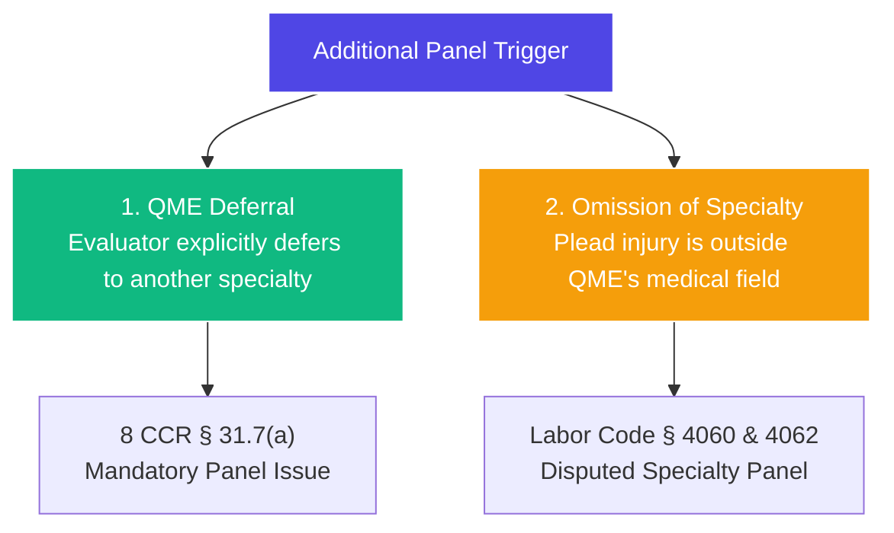

# ⚖️ LITIGATION PLAYBOOK: ADDITIONAL PANEL QME STRATEGY
**Objective:** How to successfully force the DWC Medical Unit or the WCJ to issue additional QME panels in separate specialties to maximize medical evidence and disability ratings.

---

## 🎯 THE STRATEGIC SCENARIOS

An additional QME panel is required when a worker has sustained injuries that span multiple, distinct medical specialties (e.g., Orthopedic, Psychiatric, Internal/Cardiology, Neurology). We leverage two primary triggers to obtain these panels:

---

## 🔱 PLAY 1: THE QME DEFERRAL ROUTE
*   **The Scenario:** The Orthopedic QME (like Dr. Katz in the Zarate case or Dr. Sheibani in the Blanco case) evaluates the worker and notes that the worker has complaints of sleep loss, severe anxiety, gastritis, high blood pressure, or neurological numbness. Because these are outside their specialty, the doctor writes: *"I defer these non-orthopedic issues to the appropriate psychiatric / internal medicine / neurological specialists."*
*   **The Governing Rule:** **8 CCR § 31.7(a)**
    *   *The Mandate:* If an evaluating QME addresses an issue that is outside their scope of practice and **explicitly defers** the issue to another specialty, the Medical Unit **MUST** issue an additional QME panel in the deferred specialty upon a party's written request.
*   **The Action:** 
    1.  Immediately file a formal **Request for an Additional Panel QME** with the DWC Medical Unit, attaching the specific page of the QME's report showing the deferral.
    2.  If the defense objects or the Medical Unit delays, file a **Petition for Additional Panel QME** before the WCAB. Cite **Tyler v. WCAB** and the QME's own deferral, establishing that the record cannot be developed without the deferred specialty evaluation.

---

## 🔱 PLAY 2: THE OUTSIDE-SPECIALTY OMISSION ROUTE
*   **The Scenario:** The Application for Adjudication of Claim specifically pleads "psyche," "internal," or "neurological" injuries, but the defense only requests an Orthopedic panel, or the existing QME report completely ignores these systems.
*   **The Governing Rule:** **Labor Code § 4060 (Compensability Disputes) or § 4062 (Medical Disputes)** and **8 CCR § 32.5(d)**
    *   *The Mandate:* A party is entitled to a medical-legal evaluation in any specialty where there is a disputed medical issue or a denied claimed body system. A single orthopedic evaluator cannot legally resolve psychological or neurological permanent impairment.
*   **The Action:**
    1.  Issue a formal **meet-and-confer / objection letter** to the defense under Labor Code § 4062, demanding they agree to a QME panel in the omitted specialty.
    2.  If the defense refuses, file a **Petition for Order Compelling Additional QME Panel** before the WCAB. 
    3.  *Courtroom Argument:* Cite **Tyler v. WCAB**. Argue that leaving pleaded, treating body systems unevaluated violates the constitutional mandate to develop the record. The WCJ has the power to order the DWC Medical Unit to issue the additional panel.

---

## 📝 TEMPLATE PLEADINGS KEYSTONE TEXT
Use this standard argument in all Additional Panel Petitions:
> *"Pursuant to **8 CCR § 31.7**, an additional QME panel is required when the primary evaluator defers to another medical specialty. Furthermore, under the landmark Court of Appeal authority in **Tyler v. WCAB (1997) 56 Cal.App.4th 389**, the Appeals Board has an affirmative duty to develop the record. Adjudicating a case involving complex internal, psychiatric, and neurological injuries solely on an orthopedic report would result in an inadequate medical record. Accordingly, Applicant requests that the Court issue an Order directing the DWC Medical Unit to release additional QME panels in the specialties of [Psychiatry / Internal Medicine / Neurology]."*
