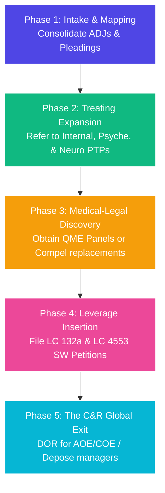

# ⚖️ LITIGATION PLAYBOOK: STANDARD CASE FLOW FOR TOP-DOLLAR SETTLEMENTS
**Objective:** How to duplicate our strategic case progression across every client in the firm to maximize case velocity, expand medical evidence, and force premium, six-figure global Compromise & Release (C&R) settlements.

---

## 🔱 PART 1: HOW THE STRATEGY IS DERIVED

This strategy is derived by reversing the standard defense playbook. 
*   **The Defense Strategy (Delay & Deny):** The defense wants to keep the case limited to a single, conservative Orthopedic QME. They rely on Applicant attorneys being disorganized, letting medical treatment lapse, and accepting a minor 5% to 10% permanent disability rating.
*   **The GenieFlow Strategy (Maximize & Force):** We expand the medical record across multiple specialties (Internal, Psyche, Neuro, Ortho) and weaponize uninsurable, out-of-pocket employer liabilities (132a / Serious & Willful).

### The Mathematical Secret to Top-Dollar Ratings (CVC Compounding)
Under the California **Combined Values Chart (CVC)**, ratings from separate specialties do not simply add up; they compound. But more specialties mean exponentially more value:

$$\text{Final WPI} = A + B(1 - A)$$

If you only have an Orthopedic rating ($20\%$ WPI), the case is cheap. But if we expand the record:
*   **Orthopedic WPI:** $20\%$
*   **Internal Medicine WPI:** $20\%$
*   **Psychiatric WPI:** $15\%$
*   **Neurological WPI:** $10\%$

Using the CVC compound formula, these ratings combine to a massive **$50\%$ Whole Person Impairment (WPI)**! 
A $50\%$ WPI translates to hundreds of thousands of dollars in permanent disability indemnity, plus a massive future medical care valuation, **raising the C&R settlement value from $20,000 to $250,000+!**

---

## ⏱️ PART 2: THE 5-PHASE DUPLICATION PIPELINE

To duplicate this success, every single case that enters your firm must be pushed through the exact same **5-Phase Case progression line**:

---

### 📍 Phase 1: Intake, Mapping & Consolidation
*   **The Action:** Create the client's `.md` Case Summary Playbook. List every consolidated ADJ case and Date of Injury (DOI).
*   *Why:* Ensures that a settlement of one case requires a settlement of ALL. It prevents the defense from settling a minor finger case and leaving the major back/stroke case open.

### 📍 Phase 2: Multi-Specialist Treating Expansion (Medical Maximization)
*   **The Action:** Refer the client immediately to active Primary Treating Physicians (PTPs) in every affected specialty:
    *   **Internal Medicine PTP:** (For sleep issues, high blood pressure, gastrointestinal/acid reflux).
    *   **Psychiatry/Psyche PTP:** (For chronic pain, depression, anxiety, PTSD).
    *   **Neurology PTP:** (For numbness, radiculopathy, stroke, head injuries).
*   *Why:* Standardizes active treatment. PTP progress reports showing active, non-MMI status block the defense from filing DORs and build a mountain of supportive medical evidence.

### 📍 Phase 3: Discovery Execution & Auditing
*   **The Action:** Obtain QME panels.
    *   *Audit:* If the QME report is favorable, keep it and rate it. 
    *   *Strike:* If the QME report is unfavorable and late-served, use **8 CCR § 38** to notice their deposition on mailing protocols and request a **Replacement QME Panel** from the Medical Unit or Compel it via Court.

### 📍 Phase 4: Leverage Insertion (Uninsurable Petitions)
*   **The Action:** Audit the employer’s conduct.
    *   Was the worker fired shortly after the injury? **File a Labor Code § 132a Petition.**
    *   Was the injury caused by a clear safety violation (bad truck brakes, broken brackets)? **File a Labor Code § 4553 Serious & Willful (S&W) Petition.**
*   *Why:* These penalties are **non-insurable** and must be paid by the employer out-of-pocket. This causes the employer to panic and force their insurance carrier to settle the entire case globally.

### 📍 Phase 5: The Global C&R Exit (Top-Dollar Settlement)
*   **The Action:** 
    1.  File a **DOR for an Expedited Hearing on AOE/COE / TTD / Medical Treatment** to get the Judge to order the State/carrier to pay TTD immediately.
    2.  Notice the depositions of the employer’s managers (Morales, Ramos, etc.) on the 132a and Serious & Willful claims under penalty of perjury.
    3.  Present the global Compromise & Release (C&R) package: *"We will dismiss all claims-in-chief, the 132a petition, and the S&W petition globally for [Top Dollar Number]."*
*   *Why:* The combination of uninsurable personal liability and a fully developed multi-specialty medical record leaves the defense with zero escape routes. They will pay top-dollar to get out.
