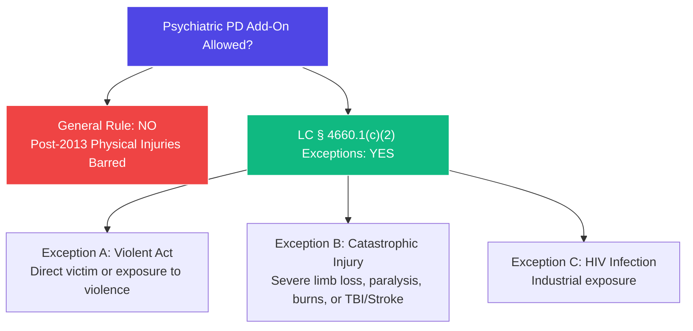

# ⚖️ LITIGATION PLAYBOOK: CATASTROPHIC INJURY & SECONDARY PSYCHE
**Objective:** How to bypass the SB 863 statutory bar on secondary psychiatric permanent disability (PD) add-ons by aggressively leveraging the "Catastrophic Injury" and "Violent Act" exceptions under **Labor Code § 4660.1(c)(2)**.

---

## 🎯 THE STATUTORY BAR & THE CRITICAL EXCEPTIONS

For injuries occurring on or after January 1, 2013, **Labor Code § 4660.1(c)(1)** prohibits any increase in a permanent impairment rating for secondary psychiatric, sleep, or sexual dysfunction disorders arising out of a physical industrial injury. 

However, **Labor Code § 4660.1(c)(2)** provides three **absolute, powerful exceptions** where secondary psychiatric permanent disability **is fully compensable**:

---

## 🔱 PLAY 1: THE "CATASTROPHIC INJURY" EXCEPTION (TBI, STROKE, HEAD TRAUMA)
*   **The Scenario:** The worker sustains a catastrophic event such as an industrial stroke (like Gilberto Blanco's 2014 stroke), a traumatic brain injury (TBI), severe head trauma, or an injury resulting in paralysis. The insurance carrier attempts to deny any psychiatric permanent disability rating, citing the post-2013 SB 863 statutory bar.
*   **The Governing Law: Labor Code § 4660.1(c)(2)(B)**
    *   *The Rule:* The statutory bar on psychiatric permanent impairment does **not** apply if the physical injury is *catastrophic*, which explicitly includes severe paralysis, severe loss of limb, severe burns, or **severe head/brain injury**.
*   **The Action & Legal Strategy:**
    1.  **Plead the Head/Brain/Stroke Injury Broadly:** In your Application for Adjudication, ensure "head," "brain," "circulatory," and "psyche" are all explicitly pleaded.
    2.  **Establish a Traumatic Brain Injury (TBI) or Stroke Record:** Obtain MRI, CT scan, or Neurological / Neuropsychological reporting confirming objective organic brain dysfunction, stroke, or cognitive impairment.
    3.  **Argument to the Court:** Argue that an industrial stroke or organic head trauma is, by definition, a "catastrophic injury" affecting the central nervous system. Because it is catastrophic, the Applicant is fully entitled to have their secondary psychiatric permanent disability (depression, anxiety, sleep disorders, cognitive decay) calculated into their **final aggregate Permanent Disability (PD) rating** under the express exception of *Labor Code § 4660.1(c)(2)(B)*.

---

## 🔱 PLAY 2: THE "VIOLENT ACT" EXCEPTION (VEHICLE COLLISIONS, CRUSH ACCIDENTS)
*   **The Scenario:** The worker is involved in a severe, frightening industrial accident—such as being struck by a falling heavy object (like the GMC transmission crushing Gilberto Blanco's shoulder and chest in 2017) or being involved in a high-speed vehicle collision (like Blanco's 2025 truck crash). 
*   **The Governing Law: Labor Code § 4660.1(c)(2)(A)**
    *   *The Rule:* The statutory bar on psychiatric permanent impairment does **not** apply if the worker was the victim of a *violent act* or was directly exposed to a significant violent act.
*   **The Action & Legal Strategy:**
    1.  **Define "Violent Act" Broadly:** Under WCAB case law, a "violent act" does not require criminal intent or human-on-human assault. A severe vehicular collision or being crushed by falling heavy industrial machinery is legally defined as a "violent act" because it involves the application of extreme, sudden physical force against the worker's body.
    2.  **Cite en banc Precedent:** *Larsen v. Securitas Security Services (2016) 81 Cal.Comp.Cases 513* (en banc) establishes that a violent act is defined as an act characterized by physical force. High-speed collisions and crushing forces fall squarely under this definition.
    3.  **Argument to the Court:** Because the underlying physical injury was caused by a "violent act" (the transmission crush or vehicle collision), the secondary psychological impairment is **fully compensable and rating-eligible** under *Labor Code § 4660.1(c)(2)(A)*.

---

## 📝 TEMPLATE PLEADINGS KEYSTONE TEXT
Use this standard argument in all Catastrophic/Violent Act Psychiatric Petitions:
> *"Although **Labor Code § 4660.1(c)(1)** generally bars psychiatric permanent impairment ratings arising from physical injuries, the Legislature carved out absolute exceptions for 'violent acts' and 'catastrophic injuries' under **§ 4660.1(c)(2)**. In the instant case, the Applicant sustained a [catastrophic industrial stroke / severe traumatic crushing force / high-speed vehicular collision] characterizable as a [violent act / catastrophic brain injury] under **Larsen v. Securitas** and **Labor Code § 4660.1(c)(2)**. Accordingly, Applicant's secondary psychiatric impairment is fully compensable and must be calculated into the final permanent disability rating to ensure a complete, lawful award based on substantial medical evidence."*
