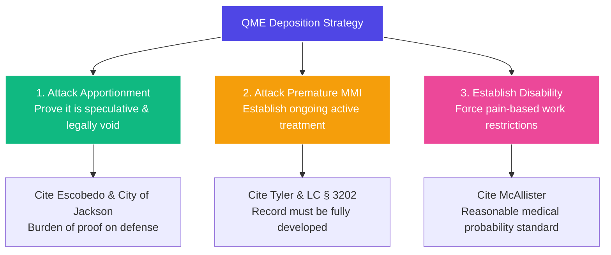

# ⚖️ LITIGATION PLAYBOOK: QME DEPOSITION CROSS-EXAMINATION TACTICS
**Objective:** Dismantling an adverse or biased Panel QME's report during cross-examination when they deny disability (0% PD / premature P&S) or apportion away the injury to non-industrial factors.

---

## 🎯 THE DEPOSITION OBJECTIVES
Your cross-examination has one goal: **render the QME's adverse report legally inadmissible as "substantial medical evidence."** Under California law, if a QME's report lacks substantial evidence, it must be thrown out, forcing the Court to rely on the treating doctor or order a new panel.

---

## 🔱 TACTIC 1: DISMANTLING BIASED APPORTIONMENT
*   **The Governing Law:** **`Escobedo v. Marshalls` (2005) 70 Cal.Comp.Cases 605 (en banc)** and **`City of Jackson v. WCAB` (2017) 11 Cal.App.5th 587**.
    *   *The Rule:* Apportionment is **not** substantial medical evidence if it is based on speculation, raw percentages, or a mere "prior history." The defense has the burden to prove that the pre-existing pathology was actively causing a disability or would have inevitably caused a disability *absent* the industrial injury.
*   **Deposition Questioning Line (The Box-In):**
    1.  *"Doctor, prior to the industrial injury of [Date], did the Applicant have any formal work restrictions on this [body part]?"* (He will say no).
    2.  *"Did he lose a single day of work or lose any wages due to this body part prior to the industrial injury?"* (He will say no).
    3.  *"Doctor, is your apportionment percentage based on the mere presence of asymptomatic, degenerative changes visible on X-ray or MRI?"* 
    4.  *"You agree that millions of hard-working Californians perform heavy labor every day with asymptomatic degenerative disc disease or arthritis without any functional disability, correct?"*
    5.  *"Doctor, under the en banc authority of **Escobedo**, apportionment to a pre-existing pathology is legally invalid if that pathology was completely asymptomatic, non-disabling, and did not limit the worker's ability to perform his duties prior to the industrial trauma. Based on that legal standard, you cannot point to a single pre-existing functional disability prior to this injury, correct?"*

---

## 🔱 TACTIC 2: DEFEATING PREMATURE MMI / "NO DISABILITY" FINDINGS
*   **The Governing Law:** **`McAllister v. WCAB` (1968)** (Reasonable medical probability standard) and **`Labor Code § 3202`** (Liberal construction in favor of injured workers).
*   **Deposition Questioning Line (Establishing Impairment):**
    1.  *"Doctor, you state the patient is permanent and stationary with 0% whole person impairment. However, you also note in your exam that the patient has a restricted range of motion, chronic muscle spasms, and severe pain on a daily basis, correct?"*
    2.  *"Under the AMA Guides, Fifth Edition, pain and restricted range of motion are objective clinical findings that contribute to impairment, correct?"*
    3.  *"Doctor, because of the patient's severe chronic pain, you would advise him to avoid heavy lifting or repetitive bending to prevent further injury, correct?"*
    4.  *"A medical recommendation to 'avoid heavy lifting' is a formal work restriction under California law, is it not?"*
    5.  *"And a permanent work restriction, by definition, constitutes a permanent disability under the California rating schedule, correct, Doctor?"*

---

## 🔱 TACTIC 3: DEFINDING PREMATURE MMI / P&S STATUS
*   **The Goal:** Prove that the QME rushed to close the case while the injured worker still needed curative medical care.
*   **Deposition Questioning Line (Ongoing Cure):**
    1.  *"Doctor, you declared the Applicant permanent and stationary on [Date]. However, you also recommended that the Applicant undergo [spinal surgery / knee joint replacement / active physical therapy] in the future, correct?"*
    2.  *"Is that recommended surgery or treatment intended to cure or relieve the effects of the industrial injury?"* (He must say yes).
    3.  *"Under California law, a patient is not permanent and stationary if they are still actively undergoing, or are candidates for, curative medical treatment that could improve their functional capacity, correct?"*
    4.  *"Therefore, declaring this patient permanent and stationary while they are still awaiting authorized, curative surgery is medically premature, is it not, Doctor?"*

---

## 📝 PRO-TIPS FOR DEPOSITION CROSS-EXAMINATION
*   **Never let them hide behind "aging":** If the QME blames "aging" or "wear-and-tear," instantly remind them: *"Doctor, the cumulative trauma injury is, by definition, wear-and-tear caused by 16 years of continuous, repetitive heavy lifting for the employer. You are not apportioning to aging—you are apportioning to the work, which is 100% compensable under California law."*
*   **Force a Supplemental Report:** Use the deposition transcript to file a **Petition to Order QME to Issue a Supplemental Report** or **Strike Report** because the doctor admitted on the record that their apportionment was speculative and did not meet the *Escobedo* standard.
