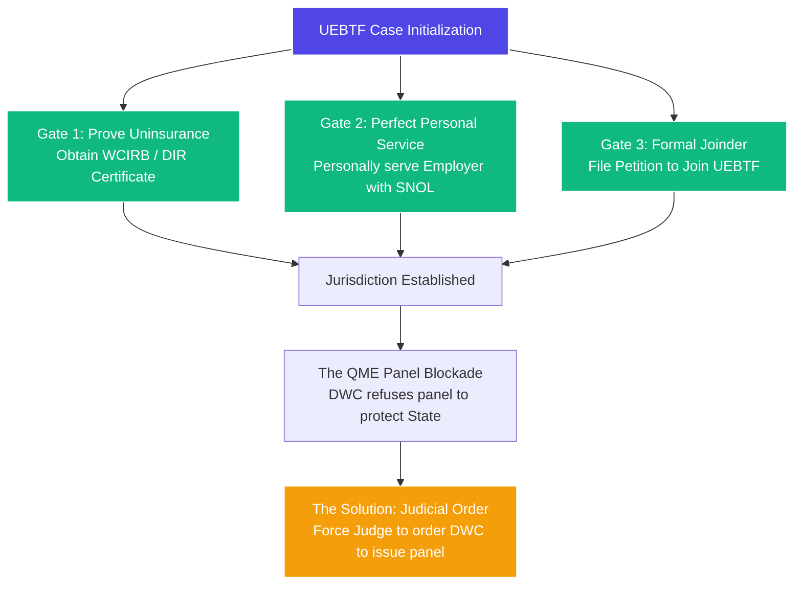

# ⚖️ LITIGATION PLAYBOOK: UEBTF LITIGATION & HEARING WORKFLOW
**Objective:** How to successfully navigate the highly technical, hostile Uninsured Employers Benefits Trust Fund (UEBTF) process, bypass the DWC Medical Unit's QME panel blockades, and secure benefits for injured workers whose employers are illegally uninsured.

---

## 🧭 THE THREE JURISDICTIONAL GATES (MANDATORY TO AVOID DISMISSAL)

The UEBTF is a state trust fund that pays benefits *only* if you strictly satisfy every jurisdictional requirement. If you miss a single service step, the UEBTF attorney will successfully dismiss the case.



---

## 🔱 THE 5-STEP LITIGATION PROTOCOL & SEQUENCE

### ⚠️ RULE 1: NEVER WARN THE EMPLOYER WITH A PRELIMINARY DEMAND
Do **NOT** contact the illegally uninsured employer with an informal letter or demand before filing. 
*   **Why?** Illegal operators will immediately close their business, hide their bank assets under family names, and dodge your process servers!
*   **The Strategy:** You file the Application and DWC SNOL *first*, and **serve them by surprise**. The Special Notice of Lawsuit (SNOL) *itself* acts as the formal statutory demand. Serving it gives you the right to attach their business and personal assets under **Labor Code § 3715** and **§ 3707**.

---

## ⏱️ THE 5-STEP SEQUENCE TO FORCING STATE PAYMENTS

```
[1. File & Serve SNOL] ➔ [2. Join UEBTF (Day 11)] ➔ [3. Court-Ordered QME] ➔ [4. QME Report] ➔ [5. AOE/COE Hearing]
```

### 📍 Step 1: The Surprise Strike (Personal Service of SNOL)
File the Application and the Special Notice of Lawsuit (SNOL) in EAMS. Immediately have a professional process server personally serve the employer. This establishes personal jurisdiction over the employer and triggers the jurisdictional timeline.

### 📍 Step 2: Join the UEBTF (The 11th Day)
Under **Labor Code § 3716(d)**, wait exactly 10 days after the employer is personally served. On the **11th day**, file your **Petition for Joinder of UEBTF** attaching the Proof of Service of the SNOL. The WCJ will sign the **Order of Joinder**, formally locking the State fund into the lawsuit.

### 📍 Step 3: Secure the QME Panel via Judicial Order
Do not wait for the backlogged DWC Medical Unit. File a **Petition for Order Compelling QME Panel** and set an Expedited Hearing. Force the WCJ to sign a **Judicial Order** directing the DWC to issue the panel immediately under **Tyler v. WCAB**. 

### 📍 Step 4: The QME Evaluation & Report
The applicant is evaluated by the QME in the requested specialty. The QME issues a comprehensive report confirming that the injury was industrial (AOE/COE) and establishing medical necessity and disability restrictions.

### 📍 Step 5: The AOE/COE Expedited Hearing & State Payment Award
Once the QME report is in, file a **Declaration of Readiness to Proceed (DOR) for an Expedited Hearing on the issues of AOE/COE, TTD, and Medical Treatment**. 
*   *At the Hearing:* Present the QME report, the SNOL Proof of Service, and the Joinder Order. 
*   *The Result:* The WCJ issues a formal **Findings & Award for AOE/COE**. Once this Award is signed, **the UEBTF is legally mandated to pay all TTD and authorize all medical treatment immediately** out of the state trust fund!

---

## 🔱 GATE 1: PROVE THE UNINSURANCE STATUS
*   **The Rule:** You must obtain official, certified proof that the employer had no workers' compensation coverage on the date of injury.
*   **The Action:** 
    1.  Submit a formal coverage search request to the **Workers' Compensation Insurance Rating Bureau (WCIRB)**.
    2.  Obtain the certified **WCIRB Coverage Certificate** showing no insurance. This must be filed in EAMS as your primary exhibit.

---

## 🔱 GATE 2: PERFECT PERSONAL SERVICE (THE #1 DISMISSAL TRAP)
*   **The Rule:** Under **Labor Code § 3716** and **8 CCR § 15570**, you must effectuate perfect **personal service** of the **Special Notice of Lawsuit (SNOL)**, the Application, and all initial forms directly upon the uninsured employer.
*   **The Action:**
    1.  Hire a professional process server to personally serve the employer at their residence or business address.
    2.  If the employer is evasive, deceased, or has fled, you **MUST** immediately file a **Petition for Substituted Service / Service by Publication** before the WCAB. 
    3.  *Warning:* Never rely on certified mail alone. UEBTF will object and throw out the case. You must obtain a signed **Proof of Personal Service** (Form POS-010) or a WCJ Order for Substituted Service.

---

## 🔱 GATE 3: THE PETITION FOR JOINDER
*   **The Rule:** UEBTF is not a party to the case until they are formally joined.
*   **The Action:**
    1.  File a **Petition to Join Uninsured Employers Benefits Trust Fund (UEBTF)**.
    2.  Serve the Petition on both the Uninsured Employer and the local UEBTF office (along with the SNOL and Proof of Personal Service on the employer).
    3.  Obtain an **Order of Joinder** signed by the WCJ.

---

## 🚧 THE DWC MEDICAL UNIT QME BLOCKADE (AND HOW TO CRUSH IT)

*   **The Problem:** Once the UEBTF is joined, you need a QME panel to establish disability and medical necessity. However, the DWC Medical Unit will often **refuse to issue the QME panel**. They claim they cannot issue a panel because the employer "has not appeared," "is not represented," or they drag their feet to protect State coffers from active claims.
*   **The Strategy (The Judicial Order Bypass):**
    1.  **Do not wait** for the Medical Unit to respond to your Form 106.
    2.  File a **Petition for Order Compelling DWC Medical Unit to Issue QME Panel**.
    3.  Set the matter for an **Expedited Hearing** or raise it at a scheduled status conference.
    4.  Argue that under **Tyler v. WCAB**, the WCJ has the absolute duty to develop the record. The Applicant cannot be held in administrative limbo indefinitely due to the employer's illegal uninsurance or the DWC's bureaucracy.
    5.  Request the WCJ sign a formal **Judicial Order Directing DWC to Issue QME Panel**. Under California law, a signed WCJ order forces the DWC Medical Unit to release the panel immediately.

---

## 🗣️ COURTROOM VERBATIM SCRIPTS FOR UEBTF HEARINGS

### 🎙️ 1. Arguing Service and Joinder compliance:
> *"Your Honor, the Applicant has fully satisfied all jurisdictional requirements. We have filed a certified WCIRB Coverage Certificate proving the employer was uninsured on the date of injury. We have personally served the Uninsured Employer with the Special Notice of Lawsuit (SNOL) on [Date], and the Proof of Service is in EAMS. UEBTF was formally joined by Order of this Court on [Date]. Jurisdiction is established."*

### 🎙️ 2. Forcing the Judicial Order for the QME Panel:
> *"However, Your Honor, the Applicant is being denied due process. The DWC Medical Unit is refusing to issue a QME panel in the specialty of [Orthopedics / Internal / Psychiatry], claiming administrative delays. The Applicant has been left without medical treatment or disability benefits since [Date]."*
>
> *"Under the established authority of **Tyler v. WCAB (1997)**, the Court has a constitutional mandate to develop the record. The illegal uninsurance of the employer cannot be used as a shield by the DWC to deny a medical-legal evaluation. We request that the Court issue a formal, signed **Judicial Order directing the DWC Medical Unit** to immediately issue a QME panel in the specialty of [Specialty] so we can progress this case."*

---

## 📝 UEBTF MASTER CHECKLIST FOR FIRM STAFF
- [ ] **Step 1:** Run WCIRB coverage search and file the certified certificate of uninsurance.
- [ ] **Step 2:** Fill out the **Special Notice of Lawsuit (SNOL)** (DWC Form).
- [ ] **Step 3:** Hire process server to personally serve the employer with SNOL + Application.
- [ ] **Step 4:** File the **Proof of Personal Service** in EAMS immediately upon receipt.
- [ ] **Step 5:** File **Petition to Join UEBTF** along with SNOL and POS.
- [ ] **Step 6:** Obtain the signed **Order of Joinder** from the WCJ.
- [ ] **Step 7:** Submit QME Panel Request. If DWC delays or rejects, file **Petition for Order Compelling QME Panel**.
- [ ] **Step 8:** Set the case for an Expedited Hearing to obtain the WCJ's signed Order to Issue Panel.
